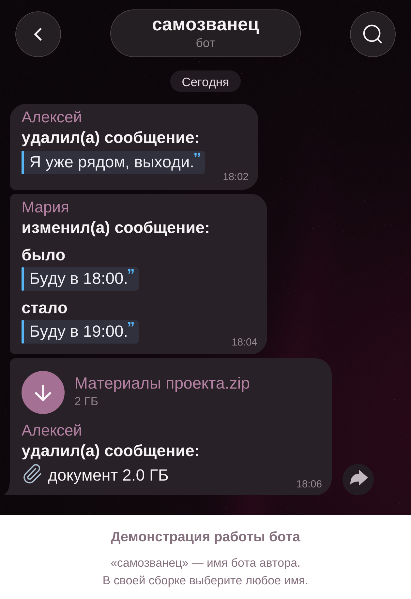

# Telegram Anti-Delete Bot

**Показывает удалённые сообщения и изменения в личной переписке.**

При удалении бот присылает копию сообщения. При редактировании — предыдущую и новую версии с пометками **было / стало**. Уведомления приходят в ваш отдельный чат с ботом.

Вы подключаете бота к аккаунту через режим секретаря Telegram. Доступные ему чаты выбираете сами.

> Бот работает с сообщениями, полученными после подключения. Ранее удалённые сообщения он не восстановит.

> Для **постоянной** работы боту нужен собственный VPS (арендованный виртуальный сервер, который работает круглосуточно без вашего участия) или другая машина, которая всегда включена. Собрать и запустить его для проверки можно на своём компьютере, но работать он будет только пока компьютер включён. Подробнее в разделе [Постоянная работа](#постоянная-работа).

[Возможности](#возможности) · [Быстрый старт](#быстрый-старт) · [Если что-то не работает](#если-что-то-не-работает) · [Ограничения](#ограничения) · [Постоянная работа](#постоянная-работа) · [Имя и описание бота](#необязательное-имя-описание-и-аватар-бота)

## Как выглядит уведомление

<p align="center">
  
</p>

## Возможности

| Что произошло | Что покажет бот |
| --- | --- |
| Удалили текстовое сообщение | Последнюю полученную версию текста |
| Изменили текст или подпись | Версии до и после правки |
| Заменили вложение | Уведомление о замене и, если файл доступен, прежнее вложение |
| Удалили фото, видео, кружок, голосовое, аудио, GIF, стикер или документ | Подпись и доступный файл |
| Удалили геопозицию, место или контакт | Координаты, название и адрес места либо имя и номер контакта — текстом |
| Удалили опрос или сообщение с кубиком | Вопрос и варианты ответа либо выпавшее значение — текстом |
| Удалили игру или счёт | Название игры или заголовок счёта — текстом |

В уведомлениях поддерживается основное форматирование текста: жирный, курсив, подчёркивание, зачёркивание, спойлеры, код и ссылки. Бот делает длинные цитаты сворачиваемыми. Вложенные цитаты упрощаются, а кастомные эмодзи заменяются обычными символами.

Обрабатываются входящие сообщения людей в доступных боту личных чатах. Собственные сообщения владельца, сообщения ботов и системного аккаунта Telegram отфильтровываются.

## Быстрый старт

Обязательно: Python 3.10 или новее, токен от [@BotFather](https://t.me/BotFather) и включённый у бота режим секретаря. Для постоянной работы ещё и машина, которая не выключается. Имя, описание и аватар бота можно задать потом или не задавать вовсе.

Зависимости устанавливаются из `requirements.txt`.

Подключение бота к аккаунту [не требует Telegram Premium](https://core.telegram.org/api/bots/connected-business-bots).

### 1. Создайте бота

Откройте [@BotFather](https://t.me/BotFather), отправьте `/newbot` и ответьте на два вопроса: как бота назвать и какой у него будет `@username`. Username должен заканчиваться на `bot` и быть свободным.

В ответ BotFather пришлёт токен, длинную строку вида `123456789:AA...`. Он понадобится на третьем шаге. Никому его не показывайте: кто знает токен, тот управляет ботом.

### 2. Установите проект

Команды для Linux и macOS:

```bash
git clone https://github.com/arianabagdasaryan02-pixel/tg-bot-anti-delete.git
cd tg-bot-anti-delete

python3 -m venv venv
source venv/bin/activate
python -m pip install -r requirements.txt
cp config.example.py config.py
```

Команды для Windows, в PowerShell или в командной строке:

```powershell
git clone https://github.com/arianabagdasaryan02-pixel/tg-bot-anti-delete.git
cd tg-bot-anti-delete

py -m venv venv
venv\Scripts\python -m pip install -r requirements.txt
copy config.example.py config.py
```

Путь перед `python` не опечатка: так вызывается Python из папки `venv`, и активировать окружение не нужно. В Windows команда активации разная в `cmd` и в PowerShell, а при ошибке срабатывает молча, поэтому надёжнее обойтись без неё. Запускать бота тогда нужно так же, через `venv\Scripts\python bot.py`.

### 3. Укажите настройки

В `config.py` заполните:

```python
BOT_TOKEN = "ВАШ_ТОКЕН"
BOT_USERNAME = "your_bot_username"  # без @
```

Токен и `config.py` не публикуйте в репозитории.

### 4. Включите режим секретаря

В [@BotFather](https://t.me/BotFather) отправьте `/mybots`, выберите своего бота и пройдите: **Bot Settings** → **Mode Settings** → **Secretary Mode**. В некоторых версиях интерфейса этот режим называется **Business Mode**.

Это позволяет подключать бота к личному аккаунту и получать события о сообщениях через [Telegram Business API](https://core.telegram.org/bots/features#business-bots).

### 5. Запустите и подключите бота

Из папки проекта. В Linux и macOS, с активированным окружением:

```bash
python bot.py
```

В Windows:

```powershell
venv\Scripts\python bot.py
```

Оставьте это окно открытым: пока бот не запущен, подключить его не получится и уведомления приходить не будут.

Откройте своего бота в Telegram и нажмите **«Запустить»**. Затем в настройках своего аккаунта найдите **«Автоматизация чатов»**, добавьте бота и выберите чаты, к которым он получит доступ. Расположение раздела зависит от версии приложения.

Для проверки попросите собеседника прислать новое сообщение в выбранный чат, изменить его и затем удалить. Уведомления появятся в чате с ботом.

## Если что-то не работает

**«Этот бот пока не поддерживает режим секретаря».** Не включён Secretary Mode, вернитесь к шагу 4.

**В журнале `Conflict: terminated by other getUpdates request`.** Запущены две копии бота с одним токеном, например на компьютере и на сервере сразу. Оставьте одну.

**Бот запускается, но молчит.** Проверьте, что он добавлен в «Автоматизацию чатов» и нужный чат попал в список доступных ему. Свои собственные сообщения бот не показывает: удалять для проверки должен собеседник.

**`ModuleNotFoundError: No module named 'telegram'`.** Зависимости поставились мимо окружения. В Windows запускайте через `venv\Scripts\python`, в Linux и macOS сначала выполните `source venv/bin/activate`.

## Ограничения

- **Нужно получить исходное сообщение.** Если исходное содержимое недоступно боту, показать прежнюю версию не получится.
- **Доступ к файлу зависит от Telegram.** Для повторной отправки по `file_id` нет лимита размера, установленного для скачивания. Запасной путь через скачивание ограничен 20 МБ в облачном Bot API. Если оба способа не сработают, оригинал может быть недоступен. [Подробнее в документации Telegram](https://core.telegram.org/bots/api#sending-files).
- **Нужно поддерживать работу бота.** После длительного простоя часть удалений и изменений может не попасть в уведомления.
- **Поддерживаются не все типы сообщений.** Например, для истории показывается только отметка о её типе, без содержимого. Опросы и геопозиции передаются текстовым описанием.

## Постоянная работа

Для проверки достаточно своего компьютера. Для постоянной работы нужен сервер или другое устройство, которое остаётся включённым. Инструкции по размещению — в [DEPLOYMENT.md](DEPLOYMENT.md).

Telegram держит неполученные события не дольше 24 часов, поэтому для постоянной работы настройте автозапуск. [Получение обновлений](https://core.telegram.org/bots/api#getting-updates).

<details>
<summary>Автозапуск через systemd</summary>

В проекте есть `avtozapusk.service`. Перед установкой укажите в нём своего пользователя (`User`), папку проекта (`WorkingDirectory`) и пути к Python и `bot.py` (`ExecStart`).

В файле стоит `RuntimeMaxSec=1d`: раз в сутки systemd перезапускает бота. Это страховка на случай, когда процесс жив, но перестал отвечать. При следующем подключении Telegram отдаёт ещё доступные события, пришедшие за время перезапуска; срок их доступности — не больше 24 часов.

```bash
sudo cp avtozapusk.service /etc/systemd/system/avtozapusk.service
sudo systemctl daemon-reload
sudo systemctl enable --now avtozapusk
systemctl status avtozapusk
```

Проверить журнал:

```bash
journalctl -u avtozapusk -n 50 --no-pager
```

</details>

<details>
<summary>Ежедневная очистка через cron</summary>

Очистку запускает отдельный скрипт `cleanup.py`. Сам `bot.py` не выполняет её по расписанию.

По умолчанию срок хранения записей — сутки: если `DAYS_TO_KEEP` отсутствует в `config.py`, используется значение `1`. Чтобы хранить дольше, добавьте строку:

```python
DAYS_TO_KEEP = 7
```

В `config.example.py` этот пример закомментирован. Если вы скопировали его в `config.py`, достаточно убрать `#` перед строкой.

Откройте `crontab -e` и добавьте строку, заменив путь на свою папку проекта:

```cron
0 4 * * * cd /home/botuser/bot && ./venv/bin/python cleanup.py >> cleanup.log 2>&1
```

Очистка будет запускаться в 04:00 по времени сервера. При запуске раз в день запись старше установленного срока может оставаться до следующей очистки.

</details>

## Необязательное: имя, описание и аватар бота

Бот работает и без этого, но до настройки он выглядит безымянным: в заголовке чата пусто, а на экране перед кнопкой «Начать» нет блока «Что умеет этот бот?».

Оформление бота в Telegram настраивается отдельно от `config.py`. Откройте [@BotFather](https://t.me/BotFather), отправьте `/mybots`, выберите своего бота и перейдите в **Edit Bot**. Также можно отправлять команды из таблицы — после каждой BotFather предложит выбрать бота.

| Что настроить | Команда | Где это увидят пользователи |
| --- | --- | --- |
| Отображаемое имя | `/setname` | В заголовке чата и профиле бота; позволяет изменить имя, выбранное при создании |
| Описание, до 512 символов | `/setdescription` | В блоке «Что умеет этот бот?» перед началом переписки |
| Краткое описание, до 120 символов | `/setabouttext` | В профиле бота и при отправке ссылки на него |
| Аватар, по желанию | `/setuserpic` | В списке чатов и профиле бота |

Выберите собственное имя: «самозванец» на демонстрации — имя бота автора. Отображаемое имя и `@username` — разные настройки. В `BOT_USERNAME` укажите именно username своего бота без `@`.

**Пример описания для `/setdescription`:**

```text
Бот для личных чатов: присылает копии удалённых сообщений, показывает текст до и после редактирования и возвращает доступные вложения. Работает с сообщениями, полученными после подключения, в выбранных чатах.
```

**Пример краткого описания для `/setabouttext`:**

```text
Удалённые сообщения, правки «было / стало» и вложения из личных чатов.
```

Сообщение после `/start` настраивается отдельно: его текст находится в `WELCOME_TEXT` в `bot.py`. Изменение описания через BotFather не меняет это приветствие.

[Подробнее об оформлении ботов в документации Telegram](https://core.telegram.org/bots/features#botfather).

## Лицензия

[MIT](LICENSE).
